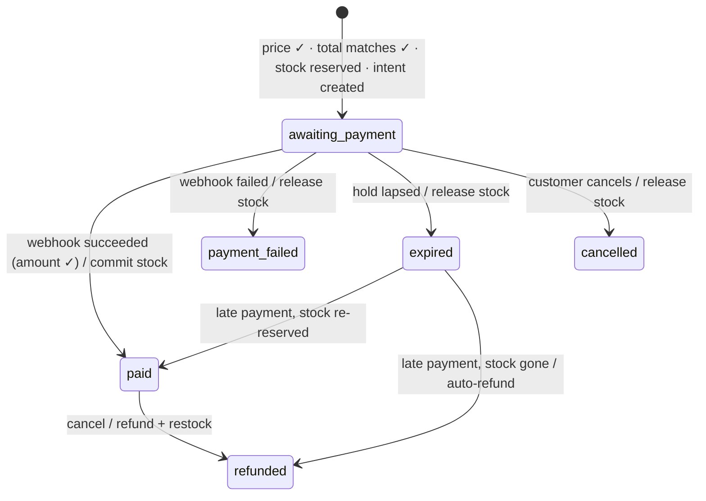

# ShopSphere

[](https://github.com/ndanetaadmire-debug/shopsphere/actions/workflows/ci.yml)


**The checkout and order backend behind a storefront** — the part where real money and real stock meet. ShopSphere focuses on the failure modes that cost e-commerce businesses money: overselling, charging the wrong amount, double-charging on retries, stranded stock and lost events.

## The hard parts, solved

| Problem | Solution | Proven by |
|---|---|---|
| **Overselling** the last unit | All-or-nothing stock reservations; `available = on_hand − held`; single-statement conditional update in SQL | Two concurrent buyers, one unit → exactly one succeeds |
| **Charging a different price** than displayed | Pure, deterministic pricing; order placement re-prices and rejects if total ≠ the total the customer saw (`409 price_changed`) | Test |
| **Lost or invented cents** in discounts | Cart coupons apportioned with largest-remainder so line totals always sum exactly to the order total | Invariant test over several distributions |
| **VAT** | 15% extracted from inclusive prices per line, exemptions respected, shipping VAT included | Test |
| **Double charges** on client retry | Per-customer `Idempotency-Key`; provider calls carry their own idempotency keys | Retry test |
| **Webhook redelivery / forgery / replay** | Dedupe by event ID; HMAC over `timestamp.body` with 5-minute tolerance; constant-time compare | Bad, stale and valid signatures |
| **Abandoned checkouts** hoarding stock | Holds expire; sweeper marks orders expired and releases stock | Test |
| **Paid after the hold expired** | Re-reserve if possible, otherwise **automatic refund** | Test |
| **Paid the wrong amount** | Not fulfilled; flagged via `order.payment_mismatch` | Test |
| **PSP outage mid-checkout** | Compensation releases the hold | Test |
| **"Order saved but email never sent"** | Transactional outbox, ordered at-least-once relay that stops at the first failure | Relay test |

## Checkout saga



Every transition writes an outbox event (`order.placed`, `order.paid`, `order.expired`, …) for email, analytics, ERP and fulfilment consumers.

## Pricing rules

- Line promotions (`percent_off_category`, `buy_x_get_y`): best single promotion per line, never stacked
- Cart coupons (`cart_fixed_off` with minimum spend), apportioned across lines
- Free shipping threshold
- All integer cents; quotes are reproducible for invoices, refunds and disputes

## Layout

```
src/
  pricing/engine.ts          pure pricing + apportionment + VAT
  inventory/reservations.ts  holds, expiry, commit/release
  orders/orderService.ts     checkout saga + compensations
  payments/gateway.ts        PSP port, webhook signature verification, fake gateway
  outbox/outbox.ts           transactional outbox + relay
  http/server.ts             Fastify API
```

## API

| Method | Path | Notes |
|---|---|---|
| `POST` | `/v1/cart/quote` | Price a cart (promotions, coupon, VAT, shipping) |
| `POST` | `/v1/orders` | Requires `Idempotency-Key` and `expectedTotalCents` |
| `GET` | `/v1/orders/:id` | Owner only (404 otherwise) |
| `POST` | `/webhooks/payments` | Signed, timestamped, deduplicated |

```bash
npm ci && npm run dev
npm run ci        # typecheck + 18 tests + build
```

---

Built by **[Admire T. Ndaneta](https://admire-portfolio.vercel.app)** — senior full-stack engineer who also runs a live Shopify store ([Lwazi Hair](https://lwazihair.co.za)). MIT licensed.
